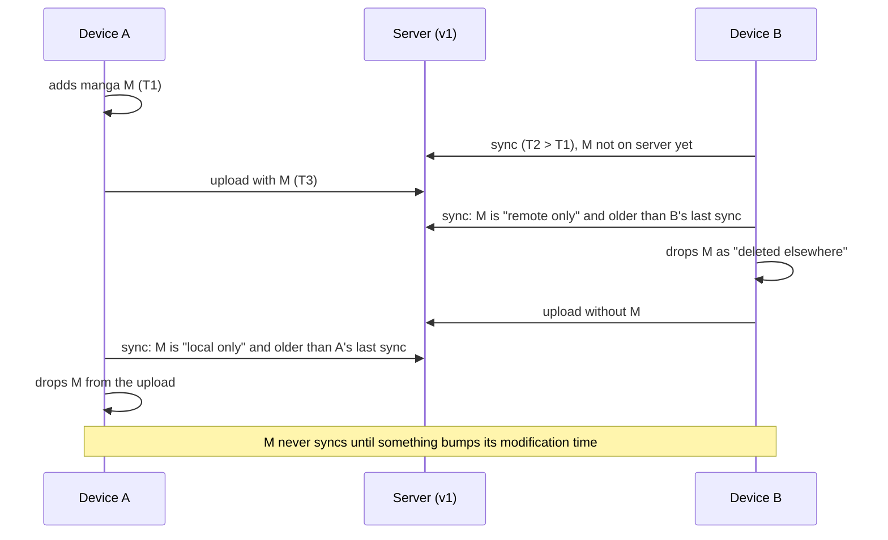
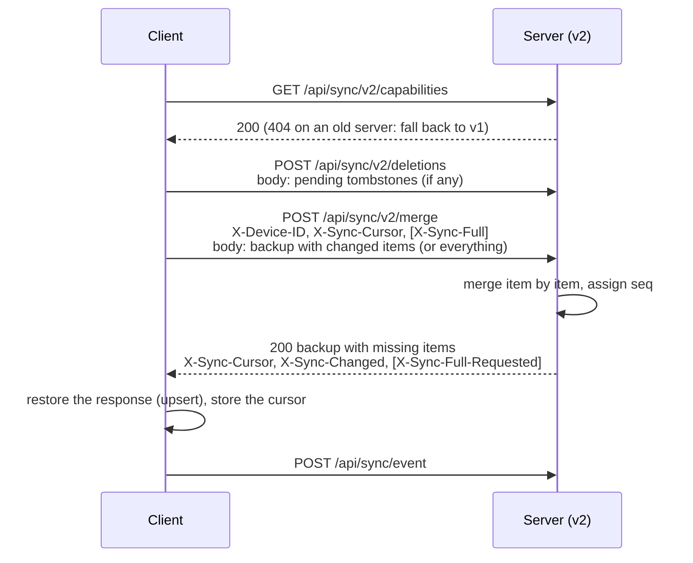
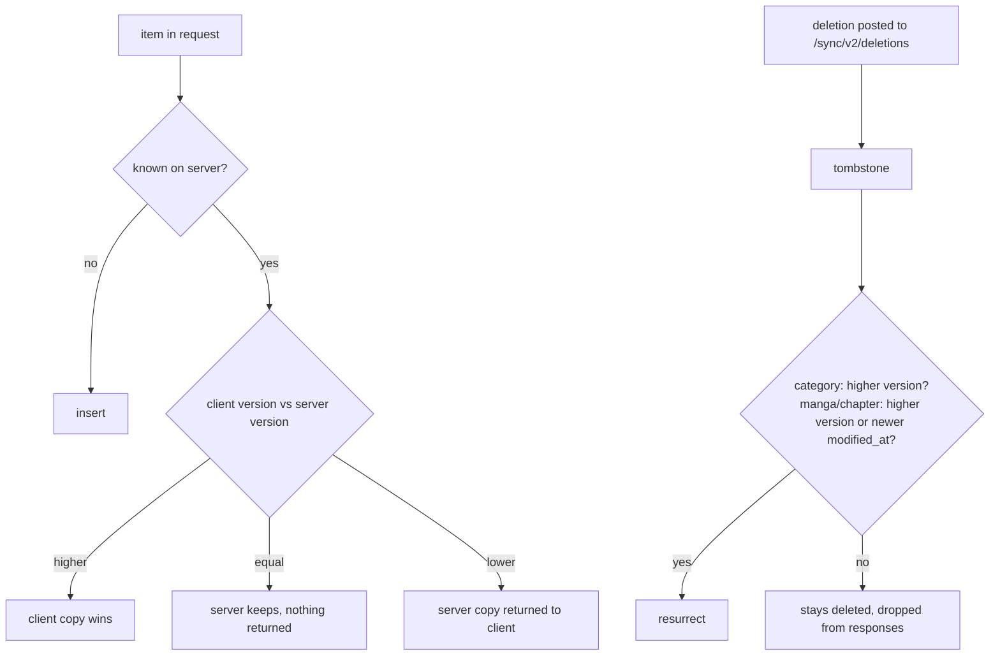

# Sync protocol v2

Protocol v2 moves the merge to the server. Clients no longer download, merge and re-upload
the whole library; they send what changed and receive what they lack. Protocol v1
(`GET`/`PUT /api/sync/content`) keeps working on top of the same data and is deprecated.

## Why

With v1 every client decided on its own that an item missing from the other side had been
deleted, by comparing the item's modification time with the client's own last-sync time.
That inference breaks with two or more devices:



Only the server knows when an item first arrived. In v2 absence never means deletion; the
only deletions are explicit tombstones.

## Round trip



## Request

| Header | Meaning |
|---|---|
| `X-Device-ID` (required) | stable identifier of the device |
| `X-Device-Name` | shown in the web UI |
| `X-Sync-Cursor` | cursor from the previous response; 0 or absent on the first sync |
| `X-Sync-Full` | `true` when the body holds the complete library |
| `X-Sync-Deleted-Categories` | deprecated alias for category tombstones: comma-separated category uids deleted since the last sync. Prefer `POST /api/sync/v2/deletions`. |
| `Content-Encoding: gzip` | optional |

Body: a Tachiyomi backup (protobuf), the same bytes the client already produces for v1.
For a delta the client includes only manga changed since its last successful upload (with
only their changed chapters), **all** categories (the server needs them to map category
numbers), and settings only when they changed. A manga without chapters in the body means
"nothing to say about chapters", never "no chapters".

The body may be sent with chunked transfer encoding, and repeated fields may arrive as
separate records: a client can write each `backup_manga` element as its own field record and
the rest of the backup after them, and protobuf merges the records into one message. This is
how the Android clients stream a large library without ever holding the encoded backup in
memory. A connection dropped mid-body fails the chunked read and the request is rejected with
400, so a partial upload is never merged.

## Response

Body: a backup with everything the client is missing:

- all live categories (so the client can map category numbers and delete categories that
  vanished),
- manga changed since the cursor by other devices (each with its complete chapter list, also
  when only one chapter changed), settings changed since the cursor, and any item where the
  server copy won over the client's,
- with `X-Sync-Cursor: 0` or `X-Sync-Full: true`: the complete library.

| Header | Meaning |
|---|---|
| `X-Sync-Cursor` | send it back next time |
| `X-Sync-Changed` | `false` when the body carries nothing new; the client can skip the restore |
| `X-Sync-Full-Requested` | `true` when the server wants a full library next time (after an import or a server-side restore) |
| `ETag` | `seq=<cursor>`, the same value v1 clients see |

Clients apply the response with their normal restore (upsert). Deleted categories are
detected by their absence from the response's category list, which is complete.

## Merge rules



- Manga are keyed by `source|url`, chapters by their url within the manga, categories by
  `uid` (falling back to name for uid-less categories). Category membership is stored as
  references to categories, so it survives different category orders on different devices.
- `version` is only ever set by the clients (their SQL triggers bump it on meaningful
  changes); the server stores the winning copy and never bumps it.
- Un-favouriting is a normal versioned change (`favorite=false` inside the manga), not a
  deletion. Chapters are deleted only by an explicit `chapter` tombstone (see
  [Deletions](#deletions)); a chapter missing from the body never deletes it.
- Settings (sources, preferences, source preferences, extension repos, saved searches) have
  no version: the client copy wins.
- Every write gets the key's next `seq`; the cursor is the current `seq`. "Changed since
  cursor" is a single indexed query.

## Deletions

Deletion is explicit: an item is deleted only when a client posts a tombstone. Absence from an
upload still means nothing (see [Why](#why)), and absence from a response is how a client
learns that an item was deleted.

### `POST /api/sync/v2/deletions`

One endpoint covers every kind. It uses the same authentication and device middleware as
`/api/sync/v2/merge`: `X-API-Token`; `X-Device-ID` is required (at most 128 characters);
`X-Device-Name` is optional.

Canonical body:

```json
{"items":[{"kind":"chapter","key":"…"},{"kind":"category","key":"uid:17"},{"kind":"manga","key":"…"}]}
```

The legacy fields that deployed clients already send are accepted in the same body and merged
and deduplicated with `items`:

```json
{"deletedChapters":["<key>", "…"], "deletedCategories":[17, 18]}
```

- `deletedChapters` is the array of chapter keys the client deleted (the same
  `<manga key>` + `0x1f` + `<chapter url>` key format).
- `deletedCategories` holds category uids; each number `n` becomes the key `uid:<n>`.

An empty body is a valid no-op.

Response `200`:

```json
{"acknowledged": 3, "applied": 1}
```

`acknowledged` is the number of accepted input entries before deduplication (duplicates still
count); `applied` is the number of rows that actually transitioned from live to deleted.
Unknown or never-seen keys are not errors: they count as acknowledged, but not as applied.

Errors: `400` for malformed JSON, an unknown `kind`, an empty `key`, or a key longer than 4096
bytes; `401` for a missing or invalid API key.

### Kinds and key formats

| `kind` | `key` |
|---|---|
| `manga` | `<source>\|<url>` |
| `chapter` | `<manga key>` + `0x1f` + `<chapter url>` |
| `category` | `uid:<uid>` or `name:<name>` |
| `source` | `<source_id>` |
| `app_pref` | `<key>` |
| `source_pref` | `<source_key>` + `0x1f` + `<key>` |
| `ext_store` | `<index_url>` |
| `saved_search` | `<name>\|<source>` |
| `extra` | `extra` |

### Tombstone semantics

A tombstone updates the existing `sync_item` row: `deleted=true`, `modified_at` = the current
Unix time in seconds, `seq` = the key's next sequence, `origin_device` = the requesting device.
There is no new table and no new column. A missing row, or a row already deleted, is a no-op
and does not advance the sequence.

### Resurrection

- `manga` and `chapter` come back for a higher `version`, or for a `modified_at` newer than the
  deletion, regardless of version. This matters for re-added items: a chapter or manga
  re-created after deletion starts again at `version = 1` while the tombstoned row may sit at
  a higher version, so the timestamp is what resurrects it.
- `category` comes back only for a higher `version`. Categories are uploaded whole on every
  sync, so a device that has not applied the delete resends its copy unchanged, and restores
  or reorders bump `last_modified_at`; a newer timestamp must not bring a deleted category
  back.
- A `name:<name>` category tombstone resolves to the stored key: if no row is stored under
  the exact `name:` key, the server looks the category up by name and tombstones the matching
  `uid:<uid>` row. A `name:` that matches no row is a no-op.
- Unversioned kinds (`source`, `app_pref`, `source_pref`, `ext_store`, `saved_search`, `extra`)
  come back only for a write whose payload differs from the tombstoned payload. A byte-identical
  re-upload from a stale device stays deleted.

### Output

Deleted items are omitted from the rendered backup, both for a delta and for a snapshot. There
is no per-item tombstone marker in the response body; clients infer deletion from absence, as
before.

### Compatibility

`X-Sync-Deleted-Categories` on `/api/sync/v2/merge` remains supported as a deprecated alias for
`{"items":[{"kind":"category","key":"uid:<n>"}]}`. `POST /api/sync/v2/deletions` with
`{"deletedChapters":["…"]}` is likewise supported for the deployed client.

A `manga` tombstone means the item is gone; it is not "removed from the library". Removing a
manga from the library remains a normal manga payload with `favorite=false`, which keeps its
chapters and history. Unlike a chapter tombstone, a `manga` tombstone is not visible in a delta
response (there is no per-item marker); only its absence from a full snapshot reveals it. No
currently deployed client emits or acts on a manga tombstone.

### Limitation

The unversioned section kinds have no client-side pending-deletion queue and no consumer, so
deleting them is durable on the server but not yet propagated to clients.

## Idempotency and concurrency

- Retrying a request is safe: identical items produce no writes and the cursor does not move.
- Merges for one API key run one at a time (in-process lock plus a row lock on Postgres).
- A cursor ahead of the server's (database restored from an older backup) is treated as 0
  and `X-Sync-Full-Requested` is returned.

## Protocol v1 on a v2 server

`PUT /api/sync/content` stores the uploaded bytes verbatim as the key's raw blob and imports
them into the item store on a best-effort basis (as a full request from a device called
`legacy`; a payload that does not decode is stored and served anyway). `GET` echoes the raw
blob byte-for-byte under its `uuid=` etag while no other device has written since, and only
then falls back to a render of the item store (`seq=` etag). `If-Match`/`If-None-Match`
keep working across both etag forms.

Consequences for v1 clients:

- Two v1 devices exchange exactly the bytes they upload, like on a pre-1.3 server: their
  client-side merge stays authoritative between them.
- Once a v2 device writes on the same key, the next v1 `GET` receives a server render
  containing both sides; the following v1 upload resumes the echo.
- Category deletions made on a v1 client propagate to other v1 clients through the blob but
  not into the item store (no tombstone); deleting the category on a v2 client does.
- Every v1 response carries `Deprecation: true`; the web UI marks such devices as *legacy*.
